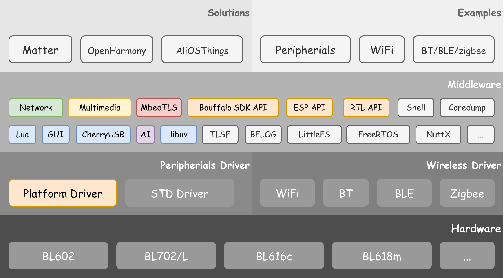

<div align="center">

# Bouffalo SDK

**The official IoT and MCU SDK for every Bouffalo Lab RISC-V chip**

Wi-Fi 4 / Wi-Fi 6 · Bluetooth LE · Zigbee · Thread · Matter

[](LICENSE)
[](https://github.com/bouffalolab/bouffalo_sdk/tags)
[](https://bl-mcu-sdk.readthedocs.io/zh_CN/latest/)
[](https://bbs.bouffalolab.com/)
[](https://github.com/bouffalolab/bouffalo_sdk/stargazers)

[Quick Start](#quick-start) · [Documentation](https://bl-mcu-sdk.readthedocs.io/zh_CN/latest/) · [Examples](examples) · [Changelog](CHANGELOG.md) · [Forum](https://bbs.bouffalolab.com/) · [中文](README_zh.md)

</div>

---

Bouffalo SDK builds firmware for all Bouffalo Lab chips from one source tree. It merges the former **bl_mcu_sdk** and **bl_iot_sdk**: one build system, one toolchain, and one peripheral driver API across the BL602, BL702, BL616 and BL618 families.

## Highlights

- **One SDK for all chips.** BL602, BL702/BL702L, BL616C/CL and BL618M/BL618DG share the same tree, build system and examples.
- **One peripheral API.** LHAL gives GPIO, UART, SPI, I2C, DMA, ADC, USB, crypto and other peripherals the same API on every chip, and is easy to port to other platforms.
- **Wireless stacks included.** Wi-Fi 4, Wi-Fi 6, Bluetooth / BLE, Zigbee, Thread and Matter.
- **Common middleware ready to use.** FreeRTOS, lwIP, mbedTLS, LVGL 8/9, CherryUSB, FatFS, LittleFS, OpenAMP, WAMR (WebAssembly) and [more](#third-party-components).
- **Simple build.** CMake with Make or Ninja, Kconfig `menuconfig`, and a single GCC 14.3 toolchain for Windows, Linux and macOS.
- **Flashing and debugging tools.** Flash Cube GUI/CLI flasher and CKLink debugging.

## Architecture

<p align="center">
  
</p>

## Supported Chips

| Chip | `CHIP` | `BOARD` | Wireless |
|---|---|---|---|
| BL602 | `bl602` | `bl602dk` | Wi-Fi 4, BLE, Matter |
| BL702 | `bl702` | `bl702dk` | Zigbee, Thread, Matter |
| BL702L / BL704L | `bl702l` | `bl702ldk` | Zigbee, Thread, Matter |
| BL616C | `bl616` | `bl616dk` | Wi-Fi 6, BT, BLE, Zigbee, Thread, Matter |
| BL616CL | `bl616cl` | `bl616cldk` | Wi-Fi 6, BT, BLE, Zigbee, Thread, Matter |
| BL618M / BL618DG | `bl618dg` | `bl618dgdk` | Wi-Fi 6, BT, BLE, Zigbee, Thread, Matter (not tested) |

The `CHIP` and `BOARD` values stay unchanged from earlier releases. BL618M/BL618DG is a multi-core chip; select the core with `CPU_ID=ap` (default) or `CPU_ID=np`.

<details>
<summary><b>Wireless support matrix</b></summary>

<br>

✅ supported · ⚠️ supported but not tested · ❌ not supported · — not available on this chip

| Protocol | BL602 | BL702/BL702L/BL704L | BL616C/CL | BL618M/BL618DG |
|---|:---:|:---:|:---:|:---:|
| Wi-Fi 4 | ✅ | — | — | — |
| Wi-Fi 6 | — | — | ✅ | ✅ |
| BT | — | — | ✅ | ✅ |
| BLE | ✅ | ❌ | ✅ | ✅ |
| Zigbee | — | ✅ | ✅ | ✅ |
| Thread | — | ✅ | ✅ | ✅ |
| Matter | ✅ | ✅ | ✅ | ⚠️ |

</details>

<details>
<summary><b>LHAL peripheral support matrix</b></summary>

<br>

✅ supported · ⚠️ supported but not tested · ❌ not supported · — not available on this chip

| Peripheral | BL602 | BL702/BL702L/BL704L | BL616C/CL | BL618M/BL618DG |
|---|:---:|:---:|:---:|:---:|
| ADC | ⚠️ | ✅ | ✅ | ✅ |
| CAM | — | ✅ | ✅ | ✅ |
| CKS | ⚠️ | ✅ | ✅ | ✅ |
| CSI | — | — | — | — |
| DAC | ⚠️ | ✅ | ✅ | ✅ |
| DMA | ⚠️ | ✅ | ✅ | ✅ |
| EFUSE | ❌ | ✅ | ✅ | ✅ |
| EMAC | — | ✅ | ✅ | ✅ |
| FLASH | ✅ | ✅ | ✅ | ✅ |
| GPIO | ⚠️ | ✅ | ✅ | ✅ |
| I2C | ⚠️ | ✅ | ✅ | ✅ |
| I2S | ⚠️ | ⚠️ | ✅ | ✅ |
| IR | ⚠️ | ✅ | ✅ | ✅ |
| MJPEG | ❌ | ❌ | ✅ | ✅ |
| PWM_v1 | ⚠️ | ✅ | — | — |
| PWM_v2 | — | — | ✅ | ✅ |
| RTC | ⚠️ | ✅ | ✅ | ✅ |
| SEC_AES | ⚠️ | ✅ | ✅ | ✅ |
| SEC_SHA | ⚠️ | ✅ | ✅ | ✅ |
| SEC_TRNG | ⚠️ | ✅ | ✅ | ✅ |
| SEC_PKA | ⚠️ | ✅ | ✅ | ✅ |
| SPI | ⚠️ | ✅ | ✅ | ✅ |
| TIMER | ⚠️ | ✅ | ✅ | ✅ |
| UART | ✅ | ✅ | ✅ | ✅ |
| USB_v1 | — | ✅ | — | — |
| USB_v2 | — | — | ✅ | ✅ |
| WDG | ⚠️ | ✅ | ✅ | ✅ |

</details>

## Quick Start

### 1. Get the source

```bash
git clone https://github.com/bouffalolab/bouffalo_sdk.git
# Mirror for users in China:
# git clone https://gitee.com/bouffalolab/bouffalo_sdk.git
```

> [!NOTE]
> Since v2.3.37 the repository uses a compact Git history so that clones and pulls are faster. To join it with the full history up to v2.3.36, run:
>
> ```bash
> git replace -f --graft 'v2.3.37-history-base^{}' 'v2.3.36^{}'
> ```

### 2. Install the toolchain

Download the GCC 14.3 toolchain for your OS (Windows, Linux x86_64 / arm64, macOS arm64) from [GitHub](https://github.com/bouffalolab/toolchain/releases/tag/default) or [Gitee](https://gitee.com/bouffalolab/toolchain/releases/tag/latest), then add its `bin` directory to `PATH`. You also need `make` or `ninja`; Windows builds of both are included in [`tools/make`](tools/make) and [`tools/ninja`](tools/ninja).

```bash
riscv64-unknown-elf-gcc --version   # check that the toolchain is on PATH
```

The full guide is in [Environment Setup](https://bl-mcu-sdk.readthedocs.io/zh_CN/latest/get_started/get_started.html).

### 3. Build an example

Every example directory contains a `main.c` and a `Makefile`. Pick `CHIP` and `BOARD` from [Supported Chips](#supported-chips):

```bash
cd examples/helloworld
make CHIP=bl616 BOARD=bl616dk          # or: make ninja CHIP=bl616 BOARD=bl616dk
```

For the multi-core BL618M/BL618DG, build each core separately:

```bash
cd examples/bl618dg_dualcore
make CHIP=bl618dg BOARD=bl618dgdk CPU_ID=ap   # AP core
make CHIP=bl618dg BOARD=bl618dgdk CPU_ID=np   # NP core
```

> [!IMPORTANT]
> Always pass `CHIP` and `BOARD`. Without them the build defaults to `CHIP=bl616 BOARD=bl616dk` and does not warn you.

Other useful targets:

```bash
make menuconfig CHIP=bl616 BOARD=bl616dk   # change Kconfig options
make clean                                 # remove the build directory
```

### 4. Flash the firmware

```bash
make flash CHIP=bl616 COMX=/dev/ttyUSB0    # Windows: COMX=COM5
```

On Linux, add your user to the `dialout` group to access serial ports without `sudo`, then log out and back in:

```bash
sudo usermod -aG dialout $USER
```

<details>
<summary><b>Maximum flashing baud rate by USB-to-serial chip</b></summary>

<br>

When flashing over a serial port rather than USB, keep the baud rate within what your USB-to-serial chip supports.

| USB-to-serial chip | Max baud rate |
|---|---|
| CH340 | 500K |
| CP2102 | 2M |
| FT232 | 2M |
| BL702 | 8M |
| BL616 | 10M |

</details>

For the graphical flasher, see the [Flash Cube User Guide](tools/bflb_tools/bouffalo_flash_cube/docs/FlashCube_User_Guide.pdf).

## Debugging

Debugging is supported with CKLink. See the [Debug Guide](https://bl-mcu-sdk.readthedocs.io/zh_CN/latest/get_started/eclipse.html); CKLink firmware is in [`tools/cklink_firmware`](tools/cklink_firmware).

## Repository Layout

```text
bouffalo_sdk/
├── bsp/
│   ├── board/      # Board init: clock, pinmux, memory heap, console
│   └── common/     # Common board drivers (LCD, image sensors, ...)
├── cmake/          # CMake build scripts
├── components/     # Middleware, wireless stacks, RTOS, file systems, graphics
├── docs/           # Quick start, API reference and demo docs
├── drivers/
│   ├── lhal/       # Common peripheral drivers for all chips
│   ├── soc/        # Chip-specific drivers
│   ├── rfparam/    # RF parameters
│   └── sys/        # System drivers
├── examples/       # Official examples
├── tests/          # Unit tests
└── tools/          # Flashing, debugging and build tools
```

## Documentation and Resources

| Resource | Link |
|---|---|
| SDK documentation: API reference, peripheral demos (Chinese) | [bl-mcu-sdk.readthedocs.io](https://bl-mcu-sdk.readthedocs.io/zh_CN/latest/) |
| Chip reference manuals and datasheets | [bouffalolab/bl_docs](https://github.com/bouffalolab/bl_docs) |
| Supported LCD panels | [bsp/common/display](bsp/common/display/README.md) |
| Supported camera sensors | [bsp/common/image_sensor](bsp/common/image_sensor/README.md) |
| Release notes | [CHANGELOG.md](CHANGELOG.md) |
| Developer forum | [bbs.bouffalolab.com](https://bbs.bouffalolab.com/) |

## Third-party Components

<details>
<summary><b>Software bill of materials (SBOM)</b></summary>

<br>

| Area | Component(s) | Original repository | Version |
|---|---|---|---|
| Multimedia | xwebsocket | https://github.com/OlehKulykov/librws | 9-Jan-19 |
| Networking | MQTT-C | https://github.com/LiamBindle/MQTT-C | 1.1.2 |
| Bluetooth | blestack | https://github.com/zephyrproject-rtos/zephyr | 2.1.0 |
| Bluetooth | sbc | https://android.googlesource.com/platform/external/bluetooth/bluedroid/ | Unknown |
| Networking | LWIP | https://github.com/lwip-tcpip/lwip | 2.1.2 |
| Networking | PPP | https://github.com/ppp-project/ppp | Unknown. Managed by upstream LWIP |
| Utils | cJSON | https://github.com/DaveGamble/cJSON | 1.7.18 |
| Runtime | WAMR | https://github.com/wasm-micro-runtime/wasm-micro-runtime | 2.4.4 |
| WLAN | hostapd, wpa_supplicant | https://w1.fi/cgit/hostap | v2.10 |
| BSP | CherryUSB | https://github.com/cherry-embedded/CherryUSB | v1.5.3 |
| BSP | FatFS | http://elm-chan.org/fsw/ff/ | R0.14c |
| BSP | FreeRTOS-Kernel | https://github.com/FreeRTOS/FreeRTOS-Kernel/ | V10.6.2 |
| BSP | LittleFS | https://github.com/littlefs-project/littlefs | v2.8 |
| BSP | Nuttx | https://github.com/apache/nuttx | Unknown |
| BSP | TLSF | https://github.com/mattconte/tlsf | v3.1 |
| Graphics | LVGL_v8 | https://github.com/lvgl/lvgl | 8.4.0 |
| Graphics | LVGL_v9 | https://github.com/lvgl/lvgl | 9.5.0 |
| Networking | mbedtls | https://github.com/Mbed-TLS/mbedtls | 2.28.2 |
| Networking | mbedtls v3 | https://github.com/Mbed-TLS/mbedtls | 3.6.5 |
| IPC | OpenAMP | https://github.com/OpenAMP/open-amp | v1.8.0 |
| IPC | libmetal | https://github.com/OpenAMP/libmetal | v1.8.0 |
| Wireless | OpenThread | https://github.com/openthread/openthread | 1.7.4 |
| Wireless | Zigbee stack | Bouffalo Lab proprietary | 1.6.68 |
| Utils | musl getopt | https://git.musl-libc.org/cgit/musl | Unknown |
| Utils | queue | https://web.mit.edu/freebsd/head/sys/sys/queue.h | 8.5 |
| Utils | tree | https://ftp.netbsd.org/pub/NetBSD/NetBSD-current/src/sys/sys/tree.h | 1.8 (NetBSD), 1.7 (OpenBSD) |

</details>

## Contributing

Bug reports and pull requests are welcome. Please search the [existing issues](https://github.com/bouffalolab/bouffalo_sdk/issues) before you open a new one, and include the chip, board, SDK version and build log in your report. For usage questions, the [forum](https://bbs.bouffalolab.com/) usually gets a faster answer.

## License

Bouffalo SDK is released under the [Apache License 2.0](LICENSE). Third-party components keep their own licenses; see [Third-party Components](#third-party-components).
