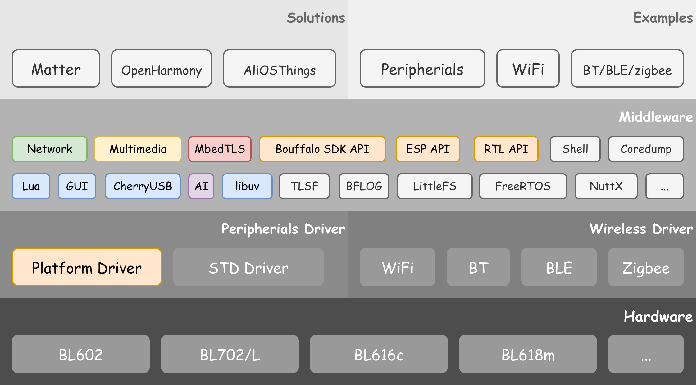

<div align="center">

# Bouffalo SDK

**博流智能全系列 RISC-V 芯片的官方 IoT 与 MCU 开发套件**

Wi-Fi 4 / Wi-Fi 6 · Bluetooth LE · Zigbee · Thread · Matter

[](LICENSE)
[](https://github.com/bouffalolab/bouffalo_sdk/tags)
[](https://bl-mcu-sdk.readthedocs.io/zh_CN/latest/)
[](https://bbs.bouffalolab.com/)
[](https://github.com/bouffalolab/bouffalo_sdk/stargazers)

[快速上手](#快速上手) · [文档](https://bl-mcu-sdk.readthedocs.io/zh_CN/latest/) · [示例](examples) · [更新日志](CHANGELOG.md) · [论坛](https://bbs.bouffalolab.com/) · [English](README.md)

</div>

---

Bouffalo SDK 用同一套源码为博流智能所有芯片构建固件。它由原来的 **bl_mcu_sdk** 和 **bl_iot_sdk** 合并而来，BL602、BL702、BL616、BL618 各系列共用一套构建系统、一套工具链和一套外设驱动 API。

## 主要特性

- **一套 SDK 覆盖全系列芯片**：BL602、BL702/BL702L、BL616C/CL、BL618M/BL618DG 共用同一套代码、构建系统和示例。
- **统一的外设 API**：LHAL 让 GPIO、UART、SPI、I2C、DMA、ADC、USB、加解密等外设在所有芯片上使用相同的接口，也方便移植到其他平台。
- **内置无线协议栈**：Wi-Fi 4、Wi-Fi 6、Bluetooth / BLE、Zigbee、Thread 和 Matter。
- **常用中间件开箱即用**：FreeRTOS、lwIP、mbedTLS、LVGL 8/9、CherryUSB、FatFS、LittleFS、OpenAMP、WAMR（WebAssembly）等，完整列表见[第三方组件](#第三方组件)。
- **构建简单**：CMake 搭配 Make 或 Ninja，支持 Kconfig `menuconfig`，Windows、Linux、macOS 使用同一套 GCC 14.3 工具链。
- **烧录与调试工具**：Flash Cube 图形界面/命令行烧录工具，支持 CKLink 调试。

## SDK 架构

<p align="center">
  
</p>

## 支持的芯片

| 芯片 | `CHIP` | `BOARD` | 无线协议 |
|---|---|---|---|
| BL602 | `bl602` | `bl602dk` | Wi-Fi 4、BLE、Matter |
| BL702 | `bl702` | `bl702dk` | Zigbee、Thread、Matter |
| BL702L / BL704L | `bl702l` | `bl702ldk` | Zigbee、Thread、Matter |
| BL616C | `bl616` | `bl616dk` | Wi-Fi 6、BT、BLE、Zigbee、Thread、Matter |
| BL616CL | `bl616cl` | `bl616cldk` | Wi-Fi 6、BT、BLE、Zigbee、Thread、Matter |
| BL618M / BL618DG | `bl618dg` | `bl618dgdk` | Wi-Fi 6、BT、BLE、Zigbee、Thread、Matter（未测试） |

`CHIP` 和 `BOARD` 的取值与以往版本相同。BL618M/BL618DG 是多核芯片，用 `CPU_ID=ap`（默认）或 `CPU_ID=np` 选择要编译的核。

<details>
<summary><b>无线协议支持情况</b></summary>

<br>

✅ 已支持 · ⚠️ 已支持但未测试 · ❌ 未支持 · — 芯片没有该功能

| 协议 | BL602 | BL702/BL702L/BL704L | BL616C/CL | BL618M/BL618DG |
|---|:---:|:---:|:---:|:---:|
| Wi-Fi 4 | ✅ | — | — | — |
| Wi-Fi 6 | — | — | ✅ | ✅ |
| BT | — | — | ✅ | ✅ |
| BLE | ✅ | ❌ | ✅ | ✅ |
| Zigbee | — | ✅ | ✅ | ✅ |
| Thread | — | ✅ | ✅ | ✅ |
| Matter | ✅ | ✅ | ✅ | ⚠️ |

</details>

<details>
<summary><b>LHAL 外设支持情况</b></summary>

<br>

✅ 已支持 · ⚠️ 已支持但未测试 · ❌ 未支持 · — 芯片没有该外设

| 外设 | BL602 | BL702/BL702L/BL704L | BL616C/CL | BL618M/BL618DG |
|---|:---:|:---:|:---:|:---:|
| ADC | ⚠️ | ✅ | ✅ | ✅ |
| CAM | — | ✅ | ✅ | ✅ |
| CKS | ⚠️ | ✅ | ✅ | ✅ |
| CSI | — | — | — | — |
| DAC | ⚠️ | ✅ | ✅ | ✅ |
| DMA | ⚠️ | ✅ | ✅ | ✅ |
| EFUSE | ❌ | ✅ | ✅ | ✅ |
| EMAC | — | ✅ | ✅ | ✅ |
| FLASH | ✅ | ✅ | ✅ | ✅ |
| GPIO | ⚠️ | ✅ | ✅ | ✅ |
| I2C | ⚠️ | ✅ | ✅ | ✅ |
| I2S | ⚠️ | ⚠️ | ✅ | ✅ |
| IR | ⚠️ | ✅ | ✅ | ✅ |
| MJPEG | ❌ | ❌ | ✅ | ✅ |
| PWM_v1 | ⚠️ | ✅ | — | — |
| PWM_v2 | — | — | ✅ | ✅ |
| RTC | ⚠️ | ✅ | ✅ | ✅ |
| SEC_AES | ⚠️ | ✅ | ✅ | ✅ |
| SEC_SHA | ⚠️ | ✅ | ✅ | ✅ |
| SEC_TRNG | ⚠️ | ✅ | ✅ | ✅ |
| SEC_PKA | ⚠️ | ✅ | ✅ | ✅ |
| SPI | ⚠️ | ✅ | ✅ | ✅ |
| TIMER | ⚠️ | ✅ | ✅ | ✅ |
| UART | ✅ | ✅ | ✅ | ✅ |
| USB_v1 | — | ✅ | — | — |
| USB_v2 | — | — | ✅ | ✅ |
| WDG | ⚠️ | ✅ | ✅ | ✅ |

</details>

## 快速上手

### 1. 获取源码

```bash
git clone https://github.com/bouffalolab/bouffalo_sdk.git
# 国内用户可使用 Gitee 镜像：
# git clone https://gitee.com/bouffalolab/bouffalo_sdk.git
```

> [!NOTE]
> 从 v2.3.37 起，仓库使用精简的 Git 历史，以加快 clone 和 pull。如需在本地与 v2.3.36 及之前的完整历史串起来，请执行：
>
> ```bash
> git replace -f --graft 'v2.3.37-history-base^{}' 'v2.3.36^{}'
> ```

### 2. 安装工具链

从 [GitHub](https://github.com/bouffalolab/toolchain/releases/tag/default)（国外）或 [Gitee](https://gitee.com/bouffalolab/toolchain/releases/tag/latest)（国内）下载对应操作系统的 GCC 14.3 工具链（Windows、Linux x86_64 / arm64、macOS arm64），把其中的 `bin` 目录加入 `PATH`。另外还需要 `make` 或 `ninja`，Windows 版本已放在 [`tools/make`](tools/make) 和 [`tools/ninja`](tools/ninja) 中。

```bash
riscv64-unknown-elf-gcc --version   # 确认工具链已加入 PATH
```

详细步骤见 [BouffaloSDK 环境搭建](https://bl-mcu-sdk.readthedocs.io/zh_CN/latest/get_started/get_started.html)。

### 3. 编译示例

每个示例目录下都有 `main.c` 和 `Makefile`。按[支持的芯片](#支持的芯片)选择 `CHIP` 和 `BOARD`：

```bash
cd examples/helloworld
make CHIP=bl616 BOARD=bl616dk          # 或：make ninja CHIP=bl616 BOARD=bl616dk
```

多核芯片 BL618M/BL618DG 需要分别编译每个核：

```bash
cd examples/bl618dg_dualcore
make CHIP=bl618dg BOARD=bl618dgdk CPU_ID=ap   # AP 核
make CHIP=bl618dg BOARD=bl618dgdk CPU_ID=np   # NP 核
```

> [!IMPORTANT]
> 务必指定 `CHIP` 和 `BOARD`。不指定时默认按 `CHIP=bl616 BOARD=bl616dk` 编译，且不会有任何提示。

其他常用命令：

```bash
make menuconfig CHIP=bl616 BOARD=bl616dk   # 修改 Kconfig 配置
make clean                                 # 删除构建目录
```

### 4. 烧录固件

```bash
make flash CHIP=bl616 COMX=/dev/ttyUSB0    # Windows 下为 COMX=COM5
```

Linux 下把当前用户加入 `dialout` 组，之后不用 `sudo` 也能访问串口，重新登录后生效：

```bash
sudo usermod -aG dialout $USER
```

<details>
<summary><b>各 USB 转串口芯片的最高烧录波特率</b></summary>

<br>

使用串口而不是 USB 烧录时，波特率不要超过 USB 转串口芯片支持的上限。

| USB 转串口芯片 | 最高波特率 |
|---|---|
| CH340 | 500K |
| CP2102 | 2M |
| FT232 | 2M |
| BL702 | 8M |
| BL616 | 10M |

</details>

图形界面烧录工具见 [Flash Cube 使用文档](tools/bflb_tools/bouffalo_flash_cube/docs/FlashCube_User_Guide.pdf)。

## 调试

支持使用 CKLink 调试，详见 [BouffaloSDK 调试指南](https://bl-mcu-sdk.readthedocs.io/zh_CN/latest/get_started/eclipse.html)；CKLink 固件在 [`tools/cklink_firmware`](tools/cklink_firmware)。

## 代码目录

```text
bouffalo_sdk/
├── bsp/
│   ├── board/      # 板级初始化：时钟、引脚、内存堆、console
│   └── common/     # 板级常用外设驱动（LCD、图像传感器等）
├── cmake/          # CMake 构建脚本
├── components/     # 中间件、无线协议栈、RTOS、文件系统、图形库
├── docs/           # 快速上手、API 手册和 demo 文档
├── drivers/
│   ├── lhal/       # 全系列芯片通用的外设驱动
│   ├── soc/        # 芯片专用驱动
│   ├── rfparam/    # 射频参数配置
│   └── sys/        # 系统驱动
├── examples/       # 官方示例
├── tests/          # 单元测试
└── tools/          # 烧录、调试和构建工具
```

## 文档与资源

| 资源 | 链接 |
|---|---|
| SDK 文档：API 手册、外设 demo | [bl-mcu-sdk.readthedocs.io](https://bl-mcu-sdk.readthedocs.io/zh_CN/latest/) |
| 芯片参考手册和数据手册 | [bouffalolab/bl_docs](https://github.com/bouffalolab/bl_docs) |
| LCD 支持列表 | [bsp/common/display](bsp/common/display/README_CN.md) |
| 摄像头传感器支持列表 | [bsp/common/image_sensor](bsp/common/image_sensor/README.md) |
| 版本更新说明 | [CHANGELOG.md](CHANGELOG.md) |
| 开发者论坛 | [bbs.bouffalolab.com](https://bbs.bouffalolab.com/) |

## 第三方组件

<details>
<summary><b>软件物料清单（SBOM）</b></summary>

<br>

| 领域 | 组件 | 上游仓库 | 版本 |
|---|---|---|---|
| Multimedia | xwebsocket | https://github.com/OlehKulykov/librws | 9-Jan-19 |
| Networking | MQTT-C | https://github.com/LiamBindle/MQTT-C | 1.1.2 |
| Bluetooth | blestack | https://github.com/zephyrproject-rtos/zephyr | 2.1.0 |
| Bluetooth | sbc | https://android.googlesource.com/platform/external/bluetooth/bluedroid/ | Unknown |
| Networking | LWIP | https://github.com/lwip-tcpip/lwip | 2.1.2 |
| Networking | PPP | https://github.com/ppp-project/ppp | Unknown. Managed by upstream LWIP |
| Utils | cJSON | https://github.com/DaveGamble/cJSON | 1.7.18 |
| Runtime | WAMR | https://github.com/wasm-micro-runtime/wasm-micro-runtime | 2.4.4 |
| WLAN | hostapd, wpa_supplicant | https://w1.fi/cgit/hostap | v2.10 |
| BSP | CherryUSB | https://github.com/cherry-embedded/CherryUSB | v1.5.3 |
| BSP | FatFS | http://elm-chan.org/fsw/ff/ | R0.14c |
| BSP | FreeRTOS-Kernel | https://github.com/FreeRTOS/FreeRTOS-Kernel/ | V10.6.2 |
| BSP | LittleFS | https://github.com/littlefs-project/littlefs | v2.8 |
| BSP | Nuttx | https://github.com/apache/nuttx | Unknown |
| BSP | TLSF | https://github.com/mattconte/tlsf | v3.1 |
| Graphics | LVGL_v8 | https://github.com/lvgl/lvgl | 8.4.0 |
| Graphics | LVGL_v9 | https://github.com/lvgl/lvgl | 9.5.0 |
| Networking | mbedtls | https://github.com/Mbed-TLS/mbedtls | 2.28.2 |
| Networking | mbedtls v3 | https://github.com/Mbed-TLS/mbedtls | 3.6.5 |
| IPC | OpenAMP | https://github.com/OpenAMP/open-amp | v1.8.0 |
| IPC | libmetal | https://github.com/OpenAMP/libmetal | v1.8.0 |
| Wireless | OpenThread | https://github.com/openthread/openthread | 1.7.4 |
| Wireless | Zigbee stack | Bouffalo Lab proprietary | 1.6.68 |
| Utils | musl getopt | https://git.musl-libc.org/cgit/musl | Unknown |
| Utils | queue | https://web.mit.edu/freebsd/head/sys/sys/queue.h | 8.5 |
| Utils | tree | https://ftp.netbsd.org/pub/NetBSD/NetBSD-current/src/sys/sys/tree.h | 1.8 (NetBSD), 1.7 (OpenBSD) |

</details>

## 参与贡献

欢迎提交 bug 报告和 pull request。新建 issue 前请先搜索[已有 issue](https://github.com/bouffalolab/bouffalo_sdk/issues)，并在报告中写明芯片、板子、SDK 版本和编译日志。使用方面的问题在[论坛](https://bbs.bouffalolab.com/)提问，通常回复更快。

## 许可证

Bouffalo SDK 采用 [Apache License 2.0](LICENSE) 授权。第三方组件沿用各自的许可证，见[第三方组件](#第三方组件)。
