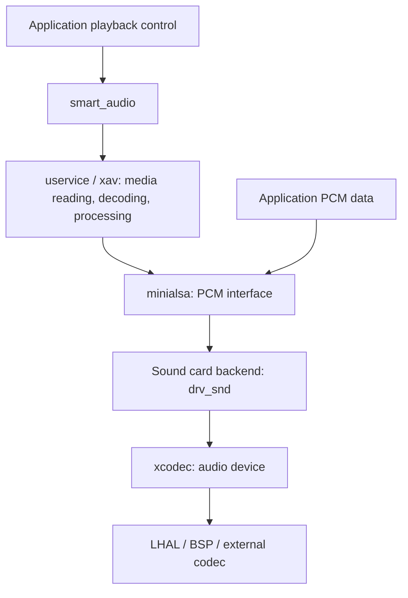

# Multimedia Audio Components

English | [简体中文](README_CN.md)

This directory provides PCM playback and capture, audio decoding, media streaming,
playback control, and audio processing. Applications can use `minialsa` to read and
write PCM directly, or use `smart_audio` to manage prompts, music, and Bluetooth playback.

## Component Layout

| Directory | Purpose | Main configuration |
| --- | --- | --- |
| [smart_audio](smart_audio/) | Multiple audio sources, priority arbitration, pause/resume, and volume | `CONFIG_SMART_AUDIO` |
| [minialsa](minialsa/) | ALSA-style PCM, sound card, and mixer interfaces | `CONFIG_MINIALSA` |
| [uservice](uservice/) | RPC services, task dispatch, and event handling | `CONFIG_USERVICE` |
| [xav](xav/) | Decoding, demuxing, stream reading, audio output, and mixing | `CONFIG_AV` |
| [xcodec](xcodec/) | Audio input/output device abstraction and codec drivers | `CONFIG_XCODEC` |
| [drv_snd](drv_snd/) | Sound card backend connecting audio devices to minialsa | `CONFIG_DRV_SND` |
| [xport](xport/) | MSP OS, filesystem, and media framework adaptation | `CONFIG_XPORT` |
| [xutils](xutils/) | Lists, device model, logging, and shared utilities | `CONFIG_XUTILS` |
| [xcommon](xcommon/) | Common multimedia code included by this directory's CMake | Built with multimedia components |
| [bluetooth_port](bluetooth_port/) | Classic Bluetooth and BLE stack adaptation | `CONFIG_BLUETOOTH_PORT` |
| [audio_flowctrl_bridge](audio_flowctrl_bridge/) | Data flow bridging for Bluetooth audio and other sources | `CONFIG_AUIDIO_FLOWCTRL_BRIDGE` |
| [xrecord](xrecord/) / [xwebsocket](xwebsocket/) | Recording service / WebSocket communication | `CONFIG_XRECORD` / `CONFIG_XWEBSOCKET` |
| `aacdec`, `pvmp3dec`, `amrnb`, `amrwb`, `opus`, `vorbis`, `speex`, `ogg` | Codec and container libraries | Corresponding `CONFIG_*` options |
| `sonic`, `speexdsp`, `libfvad` | Speed adjustment, resampling, and voice activity detection | Corresponding `CONFIG_*` options |

Use the existing spelling `CONFIG_AUIDIO_FLOWCTRL_BRIDGE` in configuration files.

## Audio Pipeline and Entry Points

Local and network playback typically use the following output pipeline.
Applications that already have PCM data enter at the minialsa layer.



| Requirement | Entry point | Example |
| --- | --- | --- |
| Play/capture PCM or verify audio hardware | `minialsa` / `msp_pcm_*` | [minialsa](../../examples/audio/minialsa/) |
| Play compressed audio from files or memory | `smart_audio` / `smtaudio_*` | [player_mp3](../../examples/audio/player_mp3/) |
| Play network music | `smart_audio` with networking and media services | [player_wifi](../../examples/audio/player_wifi/) |
| Bluetooth music or unified control of multiple sources | `smart_audio` with a Bluetooth backend | [player_bt](../../examples/audio/player_bt/), [player](../../examples/audio/player/) |

### smart_audio: Playback Control

`smart_audio` manages playback state, volume, source priorities, interruption, and
resumption. Local prompts and music use the media framework; Bluetooth A2DP uses
the Bluetooth adaptation interfaces. See [smart_audio.h](smart_audio/include/smart_audio.h)
and the [component guide](smart_audio/README.md).

Initialize board audio and register the sound card, call `smtaudio_init()`, then
register the required sources with `smtaudio_register_local_play()` and
`smtaudio_register_online_music()`. Control playback with `smtaudio_start()`,
`smtaudio_stop()`, `smtaudio_pause()`, `smtaudio_resume()`, and `smtaudio_vol_set()`;
receive results through the event callback. See the complete flow in
[player_mp3/app/player/app_player.c](../../examples/audio/player_mp3/app/player/app_player.c).

`MEDIA_SYSTEM` selects prompts and `MEDIA_MUSIC` selects music. Custom sources
implement `smtaudio_ops_node_t` and register through `smtaudio_ops_register()`.
Smaller `prio` values have higher priority.

The control layer is independent of the chip. Port the sound card, codec,
Bluetooth interfaces, and board resources for each target; these backends
determine the available functionality.

When migrating, replace `smart_audio_bl616` with `smart_audio` and
`CONFIG_SMART_AUDIO_BL616` with `CONFIG_SMART_AUDIO`, including saved menuconfig
settings. Applications continue to include `smart_audio.h` and use `smtaudio_*`.

### minialsa: PCM and Sound Cards

minialsa exposes embedded ALSA-style `msp_pcm_*` and `msp_mixer_*` APIs. See
[alsa/pcm.h](minialsa/include/alsa/pcm.h), [alsa/mixer.h](minialsa/include/alsa/mixer.h),
[alsa/snd.h](minialsa/include/alsa/snd.h), and the [component guide](minialsa/README.md).

1. Initialize board audio and register the sound card backend with `snd_card_register()`.
2. Open a device using `msp_pcm_open()`: the existing backend uses `pcmP0` for playback and `pcmC0` for capture.
3. Configure format, rate, channels, period, and buffer with `msp_pcm_hw_params_*` and `msp_pcm_hw_params()`. Configure `msp_pcm_sw_params_*` as needed, or use `msp_pcm_set_params()` for basic setup.
4. Play with `msp_pcm_writei()` or capture with `msp_pcm_readi()` / `msp_pcm_readn()`. Use `msp_pcm_avail()` and `msp_pcm_wait()` as needed.
5. Call `msp_pcm_drain()` to finish playback or `msp_pcm_drop()` to discard pending data, then `msp_pcm_close()`.

`readi` / `writei` lengths and successful return values use **PCM frames**.
`period_size` and `buffer_size` also use frames. One frame contains one sample per
channel: stereo 16-bit PCM uses 4 bytes per frame. Convert with
`msp_pcm_bytes_to_frames()` / `msp_pcm_frames_to_bytes()` before passing byte counts.

Check negative error returns. For `-EPIPE`, try `msp_pcm_recover()` and check its
result. Supported rates, sample widths, channel counts, and DMA alignment depend
on the sound card/codec backend. The `latency` argument of `msp_pcm_set_params()`
uses microseconds. Its current implementation ignores `soft_resample`; configure
resampling in the media pipeline or application if required.

For mixer control, call `msp_mixer_open()`, `msp_mixer_attach()`, and
`msp_mixer_load()`, then use `msp_mixer_selem_*` to query or set volume. Control
names, volume ranges, and dB mappings come from the backend. Check each return value.

### drv_snd: Sound Card Backend

`drv_snd` connects minialsa sound card, PCM, and mixer operations to `xcodec`,
handling playback/capture buffers, audio events, and volume. Its public interface
is [devices/drv_snd.h](drv_snd/include/devices/drv_snd.h).
Pass gain settings through `snd_config_t`, register with `snd_card_register()`,
and unregister with `snd_card_unregister()` when finished. xcodec and board ports
provide the audio device, DMA, pins, and clocks.

Update these names when migrating:

| Previous name | Current name |
| --- | --- |
| `drv_snd_bl616` / `CONFIG_DRV_SND_BL616` | `drv_snd` / `CONFIG_DRV_SND` |
| `devices/drv_snd_bl616.h` | `devices/drv_snd.h` |
| `snd_bl616_config_t` | `snd_config_t` |
| `snd_card_bl616_register()` / `snd_card_bl616_unregister()` | `snd_card_register()` / `snd_card_unregister()` |

Update saved menuconfig settings to `CONFIG_DRV_SND` and regenerate the build configuration.

### bluetooth_port: Bluetooth Stack Adaptation

`bluetooth_port` connects multimedia Bluetooth interfaces to the SDK Bluetooth
stack. `src/bt_hal.c` handles Classic Bluetooth connections, pairing, A2DP, AVRCP,
and HFP. `src/ble_hal.c` handles BLE advertising, scanning, connections, GATT, and
security. This component depends on SDK stack interfaces and internal structures;
the target must provide the required stack and profiles.

Enable `CONFIG_BLUETOOTH_PORT=y` and the required Bluetooth stack/profile options.
When migrating, replace `bl616_impls` with `bluetooth_port` and
`CONFIG_BL616_IMPLS` with `CONFIG_BLUETOOTH_PORT`, including saved menuconfig
settings. Public header and Bluetooth API names remain the same.

## Configuration and Integration

Enable components in the application's `defconfig` and select media features in
`multimedia_user.h`. `CONFIG_MULTIMEDIA=y` opens the multimedia configuration menu;
components and platform resources require their own settings. The fragments below
cover audio options; use an example's full `defconfig` and `CMakeLists.txt` as a base.

### Direct PCM Playback/Capture

```makefile
CONFIG_FREERTOS=y
CONFIG_MULTIMEDIA=y
CONFIG_MSP_USE_CODEC_ONLY=y
CONFIG_MINIALSA=y
CONFIG_DRV_SND=y
CONFIG_XCODEC=y
CONFIG_XPORT=y
CONFIG_XUTILS=y
```

`CONFIG_MSP_USE_CODEC_ONLY=y` selects a reduced path for direct audio device access
and excludes parts of the full xport/xav media pipeline. Use it for the minialsa
example; disable it for full media players.

### Media Playback and Control

Start with the audio device configuration, disable the reduced mode, and enable:

```makefile
CONFIG_MSP_USE_CODEC_ONLY=n
CONFIG_SMART_AUDIO=y
CONFIG_USERVICE=y
CONFIG_AV=y
```

Enable the required decoder libraries, such as `CONFIG_PVMP3DEC=y` for MP3.
Check `CONFIG_DECODER_*`, `CONFIG_DEMUXER_*`, `CONFIG_STREAMER_*`,
`CONFIG_RESAMPLER_*`, `CONFIG_ATEMPOER_*`, and audio effect options in
`multimedia_user.h`. Building a component and registering its media backend are
separate configuration steps; both must be enabled.

File playback requires a mounted filesystem. HTTP/HTTPS requires networking, and
HTTPS also requires TLS support. Bluetooth playback requires the stack,
`CONFIG_BT_A2DP`, adaptation, and data flow bridge options.
`CONFIG_XWEBSOCKET=y` requires POSIX support for its thread implementation.

## Board Adaptation

See [examples/audio/common/multimedia_port_common.c](../../examples/audio/common/multimedia_port_common.c)
for audio pins, PA control, DMA channels, I2S clocks, and external codec
initialization. Adaptation interfaces are in [xport/include/msp_port.h](xport/include/msp_port.h).

For external I2S codecs, enable `CONFIG_CODEC_USE_I2S=y` and check board codec
support, MCLK/BCLK/LRCLK, I2C address, and input/output pins. For on-chip ADC/DAC,
select the corresponding backend. Check DMA channel and pin allocation when
sharing peripherals with SD cards or other features.

## Building and Verifying Examples

Run these commands from the SDK root. Outputs are placed in each example's
`build/build_out/` directory.

```bash
# Direct PCM playback and capture
make -C examples/audio/minialsa CHIP=bl616 BOARD=bl616dk

# Local compressed audio playback
make -C examples/audio/player_mp3 CHIP=bl616 BOARD=bl616dk

# Full Wi-Fi / Bluetooth player
make -C examples/audio/player CHIP=bl616 BOARD=bl616dk

# BL618DG AP player
make -C examples/audio/player CHIP=bl618dg BOARD=bl618dgdk CPU_ID=ap
```

After running the minialsa example, use the serial shell:

```text
minialsa_play wa
minialsa_play sin
minialsa_api_test all wa
minialsa_api_test playback sin
minialsa_api_test capture
minialsa_output_clock_test 48000
```

`wa` and `sin` are built-in 16 kHz, 16-bit, mono PCM samples. `minialsa_api_test`
checks playback, capture, and parameter APIs; capture requires a valid configured
input. `minialsa_output_clock_test` writes silence for clock measurement and
currently requires a sample rate divisible by 8000 Hz. See
[app_minialsa.c](../../examples/audio/minialsa/app/player/app_minialsa.c) for command implementations.

## Audio Formats and Processing

Availability depends on codec libraries, media registration options, and target
resources. The table lists the main integration points.

| Category | Format or feature | Components/options |
| --- | --- | --- |
| PCM | Raw PCM, PCM in WAV | minialsa, xav PCM decoder and RAW/WAV demuxers |
| Compressed audio | MP3 | `pvmp3dec`, MP3 decoder/demuxer |
| Compressed audio | AAC, AAC in MP4/M4A | `aacdec`, AAC decoder and ADTS/MP4 demuxers |
| Compressed audio | AMR-NB / AMR-WB | `amrnb` / `amrwb`, AMR demuxer |
| Compressed audio | FLAC | xav FLAC support and media options |
| Compressed audio | Opus, Vorbis, Speex | Corresponding codec libraries and decoder options |
| Container | Ogg | `ogg`, Ogg demuxer, and decoder for the contained format |
| Bluetooth audio | A2DP / SBC | Bluetooth stack, audio adaptation, and data flow bridge |
| Media streams | File, memory, FIFO, HTTP, HLS | Corresponding `CONFIG_STREAMER_*` and filesystem/network support |
| Processing | Resampling, speed adjustment, mixing, EQ | `speexdsp`, `sonic`, and media processing options |

## Troubleshooting

- **PCM device fails to open**: Check sound card registration, device name, and enabled playback/capture backends.
- **Playback succeeds but produces no sound**: Check PA, mute, volume, codec initialization, I2S clocks, and pins.
- **Playback stutters or returns `-EPIPE`**: Check data supply, task scheduling, period/buffer sizes, and frame/byte conversion.
- **Decoder library is built but a format does not play**: Check decoder, demuxer, and streamer registration in `multimedia_user.h`.
- **Playback fails after changing chips**: Check board adaptation, audio and Bluetooth backends, and toolchain. Specify the core for BL618DG.
