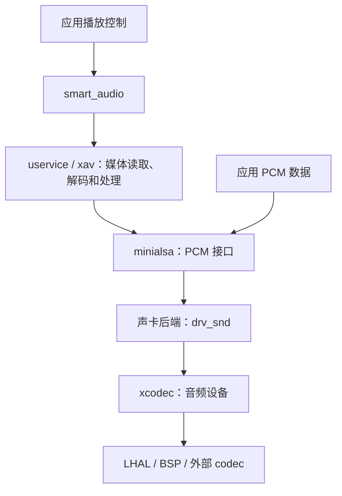

# Multimedia 音频组件

[English](README.md) | 简体中文

本目录提供 PCM 播放与采集、音频解码、媒体流读取、播放控制及音效处理组件。
应用可以直接通过 `minialsa` 读写 PCM，也可以通过 `smart_audio` 管理提示音、音乐和蓝牙播放。

## 组件结构

| 目录 | 作用 | 主要配置 |
| --- | --- | --- |
| [smart_audio](smart_audio/) | 多音源播控、优先级仲裁、暂停恢复和音量控制 | `CONFIG_SMART_AUDIO` |
| [minialsa](minialsa/) | ALSA 风格的 PCM、声卡及 mixer 接口 | `CONFIG_MINIALSA` |
| [uservice](uservice/) | RPC 服务、任务分发和事件处理 | `CONFIG_USERVICE` |
| [xav](xav/) | 解码、解封装、流读取、音频输出及混音 | `CONFIG_AV` |
| [xcodec](xcodec/) | 音频输入输出设备抽象及 codec 驱动 | `CONFIG_XCODEC` |
| [drv_snd](drv_snd/) | 将音频设备接入 minialsa 的声卡后端 | `CONFIG_DRV_SND` |
| [xport](xport/) | MSP 操作系统、文件系统和媒体框架适配 | `CONFIG_XPORT` |
| [xutils](xutils/) | 链表、设备模型、日志等公共工具 | `CONFIG_XUTILS` |
| [xcommon](xcommon/) | 多媒体公共代码，由本目录 CMake 引入 | 随多媒体组件构建 |
| [bluetooth_port](bluetooth_port/) | 经典蓝牙及 BLE 协议栈接口适配 | `CONFIG_BLUETOOTH_PORT` |
| [audio_flowctrl_bridge](audio_flowctrl_bridge/) | 蓝牙音频等数据流桥接 | `CONFIG_AUIDIO_FLOWCTRL_BRIDGE` |
| [xrecord](xrecord/) / [xwebsocket](xwebsocket/) | 录音服务 / WebSocket 通信 | `CONFIG_XRECORD` / `CONFIG_XWEBSOCKET` |
| `aacdec`、`pvmp3dec`、`amrnb`、`amrwb`、`opus`、`vorbis`、`speex`、`ogg` | 编解码及容器处理库 | 对应 `CONFIG_*` 选项 |
| `sonic`、`speexdsp`、`libfvad` | 变速、重采样等 DSP 处理、语音活动检测 | 对应 `CONFIG_*` 选项 |

`CONFIG_AUIDIO_FLOWCTRL_BRIDGE` 沿用现有配置拼写，使用时需保持一致。

## 音频链路与选型

以下为本地/网络播放的典型输出链路；直接处理 PCM 的应用从 minialsa 层接入。



| 应用需求 | 建议入口 | 参考示例 |
| --- | --- | --- |
| 已有 PCM 数据，播放、录音或验证音频硬件 | `minialsa` / `msp_pcm_*` | [minialsa 示例](../../examples/audio/minialsa/) |
| 本地文件或内存中的压缩音频播放 | `smart_audio` / `smtaudio_*` | [player_mp3](../../examples/audio/player_mp3/) |
| 网络音乐播放 | `smart_audio`，配合网络和媒体服务 | [player_wifi](../../examples/audio/player_wifi/) |
| 蓝牙音乐或多音源统一播控 | `smart_audio`，配合蓝牙适配后端 | [player_bt](../../examples/audio/player_bt/)、[player](../../examples/audio/player/) |

### smart_audio：播放控制

`smart_audio` 提供播放状态、音量、音源优先级、打断和恢复管理。
本地提示音和音乐通过媒体框架播放，蓝牙 A2DP 通过蓝牙适配接口接入。
播放类型及状态定义见 [smart_audio.h](smart_audio/include/smart_audio.h)，接口说明见 [组件 README](smart_audio/README_CN.md)。

典型初始化顺序为：初始化板级音频并注册声卡，调用 `smtaudio_init()`，
再通过 `smtaudio_register_local_play()`、`smtaudio_register_online_music()` 注册所需音源。
随后使用 `smtaudio_start()`、`smtaudio_stop()`、`smtaudio_pause()`、
`smtaudio_resume()` 和 `smtaudio_vol_set()` 控制播放，并通过事件回调接收结果。
完整流程参考 [player_mp3/app/player/app_player.c](../../examples/audio/player_mp3/app/player/app_player.c)。

`MEDIA_SYSTEM` 对应提示音，`MEDIA_MUSIC` 对应音乐；二者由注册的播放类型处理。
自定义音源可实现 `smtaudio_ops_node_t` 并调用 `smtaudio_ops_register()`；`prio` 数值越小优先级越高。

播控层与具体芯片分开：移植时应适配声卡、codec、蓝牙接口及板级资源。
实际可用功能由这些后端共同决定。

从旧版本迁移时，将目录引用 `smart_audio_bl616` 和配置 `CONFIG_SMART_AUDIO_BL616`
分别更新为 `smart_audio` 和 `CONFIG_SMART_AUDIO`，已有 menuconfig 配置也需同步更新。
应用继续包含 `smart_audio.h`，使用现有 `smtaudio_*` 接口。

### minialsa：PCM 与声卡接口

minialsa 提供嵌入式 ALSA 风格接口，公开 API 使用 `msp_pcm_*`、`msp_mixer_*` 等命名。
接口定义位于 [alsa/pcm.h](minialsa/include/alsa/pcm.h)、
[alsa/mixer.h](minialsa/include/alsa/mixer.h) 和 [alsa/snd.h](minialsa/include/alsa/snd.h)，
完整使用说明见 [minialsa 指南](minialsa/README_CN.md)。

典型使用流程：

1. 初始化板级音频并注册声卡后端。现有示例使用 `snd_card_register()`。
2. 使用 `msp_pcm_open()` 打开设备：现有后端的 `pcmP0` 用于播放，`pcmC0` 用于采集。
3. 通过 `msp_pcm_hw_params_*` 和 `msp_pcm_hw_params()` 配置格式、采样率、声道、period 和 buffer；按需配置 `msp_pcm_sw_params_*`。也可用 `msp_pcm_set_params()` 设置基本参数。
4. 播放调用 `msp_pcm_writei()`；采集调用 `msp_pcm_readi()` 或 `msp_pcm_readn()`，可配合 `msp_pcm_avail()` 和 `msp_pcm_wait()`。
5. 播放完成后调用 `msp_pcm_drain()` 等待数据输出，或调用 `msp_pcm_drop()` 丢弃缓冲数据，最后 `msp_pcm_close()`。

`readi` / `writei` 的长度和成功返回值使用 **PCM 帧**，`period_size` 和 `buffer_size` 也以帧计。
一帧包含各声道各一个采样；例如双声道 16-bit PCM 的一帧为 4 字节。
通过 `msp_pcm_bytes_to_frames()` / `msp_pcm_frames_to_bytes()` 转换单位，避免直接把字节数传给读写接口。

读写失败需检查负错误码；遇到 `-EPIPE` 时可尝试 `msp_pcm_recover()` 并检查恢复结果。
采样率、位宽、声道及 DMA 对齐约束以实际声卡/codec 后端为准。
`msp_pcm_set_params()` 的 `latency` 单位为微秒，当前实现忽略 `soft_resample` 参数；
需要重采样时应配置媒体处理链或在应用中完成。

音量控制可通过 `msp_mixer_open()`、`msp_mixer_attach()`、`msp_mixer_load()`
连接声卡并加载控制项，再使用 `msp_mixer_selem_*` 查询或设置音量。
控制项、音量范围和 dB 映射由声卡后端提供，应用应检查各步骤的返回值。

### drv_snd：声卡后端

`drv_snd` 将 minialsa 的声卡、PCM 和 mixer 操作接到 `xcodec`，负责播放/采集缓冲、
音频事件及音量控制。公开接口位于 [devices/drv_snd.h](drv_snd/include/devices/drv_snd.h)。
应用通过 `snd_config_t` 提供增益配置，使用 `snd_card_register()` 注册声卡，
并在不再使用时调用 `snd_card_unregister()`。
底层音频设备、DMA、引脚及时钟由 xcodec 和板级适配实现。

从旧版本迁移时，需同步更新以下名称：

| 旧名称 | 当前名称 |
| --- | --- |
| `drv_snd_bl616` / `CONFIG_DRV_SND_BL616` | `drv_snd` / `CONFIG_DRV_SND` |
| `devices/drv_snd_bl616.h` | `devices/drv_snd.h` |
| `snd_bl616_config_t` | `snd_config_t` |
| `snd_card_bl616_register()` / `snd_card_bl616_unregister()` | `snd_card_register()` / `snd_card_unregister()` |

已有 menuconfig 配置也需更新为 `CONFIG_DRV_SND`，再重新生成构建配置。

### bluetooth_port：蓝牙协议栈适配

`bluetooth_port` 将多媒体框架的蓝牙接口接到 SDK 蓝牙协议栈。
`src/bt_hal.c` 负责经典蓝牙连接、配对、A2DP、AVRCP 和 HFP；
`src/ble_hal.c` 负责 BLE 广播、扫描、连接、GATT 及安全管理。
该组件依赖 SDK 协议栈接口及内部结构，目标芯片需提供相应协议栈和 profile 支持。

使用时启用 `CONFIG_BLUETOOTH_PORT=y`，并配置所需的蓝牙协议栈及 profile。
从旧版本迁移时，将目录引用 `bl616_impls` 和配置 `CONFIG_BL616_IMPLS`
分别更新为 `bluetooth_port` 和 `CONFIG_BLUETOOTH_PORT`；已有 menuconfig 配置也需同步更新。
公开头文件及蓝牙接口名称保持不变。

## 配置与集成

在应用 `defconfig` 中启用组件，在 `multimedia_user.h` 中按需裁剪媒体功能。
`CONFIG_MULTIMEDIA=y` 打开多媒体配置菜单，其他组件和平台资源仍需分别配置。
以下为音频相关配置片段；完整工程请以示例的 `defconfig` 和 `CMakeLists.txt` 为基础。

### 直接 PCM 播放/采集

```makefile
CONFIG_FREERTOS=y
CONFIG_MULTIMEDIA=y
CONFIG_MSP_USE_CODEC_ONLY=y
CONFIG_MINIALSA=y
CONFIG_DRV_SND=y
CONFIG_XCODEC=y
CONFIG_XPORT=y
CONFIG_XUTILS=y
```

`CONFIG_MSP_USE_CODEC_ONLY=y` 用于直接使用音频设备的精简路径，会裁剪 xport/xav 的完整媒体处理部分。
它适用于 minialsa 示例，完整播放器应关闭此选项。

### 媒体播放与播控

在音频设备配置基础上关闭精简模式并启用：

```makefile
CONFIG_MSP_USE_CODEC_ONLY=n
CONFIG_SMART_AUDIO=y
CONFIG_USERVICE=y
CONFIG_AV=y
```

按音频格式启用相应解码库，例如 MP3 使用 `CONFIG_PVMP3DEC=y`。
同时核对应用 `multimedia_user.h` 的 `CONFIG_DECODER_*`、`CONFIG_DEMUXER_*`、
`CONFIG_STREAMER_*`、`CONFIG_RESAMPLER_*`、`CONFIG_ATEMPOER_*` 及音效开关。
组件加入构建和媒体后端注册是两个配置步骤，需配套启用。

文件播放需要对应文件系统和挂载；HTTP/HTTPS 播放需要网络，HTTPS 还需 TLS 支持。
蓝牙播放需配套蓝牙协议栈、`CONFIG_BT_A2DP`、适配实现及数据流桥接配置。
启用 `CONFIG_XWEBSOCKET=y` 时，需提供其线程实现依赖的 POSIX 支持。

## 板级适配

音频引脚、PA 控制、DMA 通道、I2S 时钟及外部 codec 初始化集中参考
[examples/audio/common/multimedia_port_common.c](../../examples/audio/common/multimedia_port_common.c)，
适配接口见 [xport/include/msp_port.h](xport/include/msp_port.h)。

使用外部 I2S codec 时启用 `CONFIG_CODEC_USE_I2S=y`，并核对板级 codec 支持、
MCLK/BCLK/LRCLK、I2C 地址和输入输出引脚。直接使用片上 ADC/DAC 时选择对应音频后端。
DMA、SD 卡等功能共享外设资源，集成时需确认通道和引脚分配。

## 示例构建与验证

以下命令从 SDK 根目录执行，构建产物位于对应示例的 `build/build_out/`。

```bash
# 直接 PCM 播放与采集
make -C examples/audio/minialsa CHIP=bl616 BOARD=bl616dk

# 本地压缩音频播放
make -C examples/audio/player_mp3 CHIP=bl616 BOARD=bl616dk

# Wi-Fi / 蓝牙完整播放器
make -C examples/audio/player CHIP=bl616 BOARD=bl616dk

# BL618DG AP 核播放器
make -C examples/audio/player CHIP=bl618dg BOARD=bl618dgdk CPU_ID=ap
```

运行 minialsa 示例后，可在串口 shell 中执行：

```text
minialsa_play wa
minialsa_play sin
minialsa_api_test all wa
minialsa_api_test playback sin
minialsa_api_test capture
minialsa_output_clock_test 48000
```

`wa` 和 `sin` 是内置的 16 kHz、16-bit、单声道 PCM 样本。
`minialsa_api_test` 验证播放、采集及参数接口；采集需连接并配置有效输入。
`minialsa_output_clock_test` 输出静音数据以便测量时钟，当前参数要求采样率为 8000 Hz 的整数倍。
命令实现见 [app_minialsa.c](../../examples/audio/minialsa/app/player/app_minialsa.c)。

## 音频格式与处理能力

可用能力取决于编解码库、媒体注册配置和目标平台资源；下表列出主要接入位置。

| 类型 | 格式或功能 | 相关组件/配置 |
| --- | --- | --- |
| PCM | 原始 PCM、WAV 中的 PCM | minialsa、xav 的 PCM 解码/RAW/WAV 解封装 |
| 压缩音频 | MP3 | `pvmp3dec`、MP3 解码及解封装 |
| 压缩音频 | AAC、MP4/M4A 中的 AAC | `aacdec`、AAC 解码及 ADTS/MP4 解封装 |
| 压缩音频 | AMR-NB / AMR-WB | `amrnb` / `amrwb`、AMR 解封装 |
| 压缩音频 | FLAC | xav 中的 FLAC 支持及对应媒体开关 |
| 压缩音频 | Opus、Vorbis、Speex | 对应 codec 库及解码配置 |
| 容器 | Ogg | `ogg`、Ogg 解封装及所含音频对应的解码器 |
| 蓝牙音频 | A2DP / SBC | 蓝牙协议栈、音频适配及数据流桥接 |
| 媒体流 | 文件、内存、FIFO、HTTP、HLS | 对应 `CONFIG_STREAMER_*` 及文件系统/网络支持 |
| 音频处理 | 重采样、变速、混音、EQ | `speexdsp`、`sonic` 及媒体处理开关 |

## 常见问题

- **PCM 设备打开失败**：确认声卡已注册、设备名正确，且相应播放/采集后端已启用。
- **播放成功但无声**：核对 PA、静音、音量、codec 初始化、I2S 时钟和引脚连接。
- **播放断续或出现 `-EPIPE`**：检查供数速度、任务调度、period/buffer 大小及帧/字节换算。
- **有解码库但格式不可播放**：核对 `multimedia_user.h` 中的解码器、解封装器和 streamer 注册开关。
- **切换芯片后失败**：检查板级适配、音频设备及蓝牙后端，并核对目标工具链；BL618DG 需指定核心。
