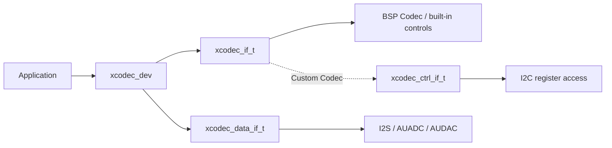

# Xcodec Device

English | [中文](./README_ZN.md)

## General information

`xcodec_dev` provides unified audio recording, playback and converter control on
Bouffalo devices. Hardware data transfer uses Bouffalo LHAL.

- Common device APIs for PCM input/output, volume, mute and microphone gain.
- Separate device, Codec control and data interfaces, with support for custom implementations.
- I2S external Codecs and built-in AUADC, AUDAC and PDM input backends.
- Channel selection, partial PCM frames, DMA buffering and shared I2S duplex operation handled by the driver.
- Driver default configurations for DMA buffering and timeouts; sample formats supplied at device open.

The following boards have implementations:

| Board         | Recording             | Playback             | Data interface       |
| ------------- | --------------------- | -------------------- | -------------------- |
| BL616DK       | Analog or PDM AUADC   | Built-in AUDAC       | Separate AUADC/AUDAC |
| BL618DG Orion | JY6166 ADC in JY6316  | JY6311 DAC in JY6316 | Shared four-slot I2S |

BL616DK selects PDM when `CONFIG_AUDIO_MIC_PDM_MODE=y`; otherwise it uses analog input.

The platform data backends currently support PCM16. JY6311, JY6166 and JY6316
controls reuse the BSP drivers. The Orion JY6316 adapter retains the BSP's
single-instance limit; separate device handles do not imply support for multiple
physical instances of every Codec. Software volume, custom volume curves and
software volume handlers are not implemented.

> **The legacy interface is deprecated.** `CONFIG_XCODEC`, `include/xcodec.h`
> and `src/bl/codec/` remain for existing applications. New applications should
> use `CONFIG_XCODEC_IO` and `include/xcodec_dev.h`. See the
> [legacy directory and migration notes](./src/bl/codec/README.md).

## Architecture overview

```text
xcodec/
├── xcodec_dev.c              # Device lifecycle, PCM IO and control dispatch
├── xcodec_dev_if.c           # Interface destruction
├── include/                  # Public device APIs, types and backend defaults
├── interface/                # Codec, data and register-control interfaces
├── platform/
│   ├── xcodec_data_i2s.c     # Shared I2S with independent RX/TX DMA
│   ├── xcodec_data_audac.c   # Built-in DAC output
│   ├── xcodec_data_auadc.c   # Built-in ADC/PDM input
│   ├── xcodec_ctrl_i2c.c     # Register access over I2C
│   └── codec_data.c/.h       # DMA rings, PCM queues and blocking transfers
├── device/
│   ├── include/              # Codec factory configurations
│   ├── audio_codec/          # BSP audio_codec adapter
│   └── builtin/              # Built-in converter volume, mute and gain
└── src/bl/codec/             # Deprecated legacy implementation
```



The control path configures the converter's rate, enable state, volume, gain and
mute through `xcodec_if_t`. The BSP adapter calls `audio_codec_*` directly; a
custom Codec can use `xcodec_ctrl_if_t` for register access. The data path moves
PCM through `xcodec_data_if_t`. GPIO, PA timing, clocks and the choice of hardware
backends belong to the Board. Applications create device handles and process PCM.

`CONFIG_XCODEC_IO` builds the new implementation without minialsa or the legacy
`msp_i2s_*` application hooks. The legacy and new implementations must not own the
same peripheral or DMA channels at the same time.

## Public interfaces and PCM format

| Interface                                     | Purpose                                                            |
| --------------------------------------------- | ------------------------------------------------------------------ |
| `xcodec_dev_cfg_t`                            | Combines device direction, Codec interface and data interface      |
| `xcodec_dev_sample_info_t`                    | Sample width, physical channels, channel mask, rate and MCLK ratio |
| `xcodec_dev_new/open/read/write/close/delete` | Device lifecycle and PCM IO                                        |
| `xcodec_if_t`                                 | Converter control                                                  |
| `xcodec_data_if_t`                            | PCM transport                                                      |
| `xcodec_ctrl_if_t`                            | Register transport                                                 |

PCM lengths are **bytes**. `read()` and `write()` return `0` only after the entire
request completes, or a negative error. Successful writes mean data was
accepted, not that it has finished playing. A timeout can occur after partial
progress; retrying the entire request can duplicate or skip audio.

Applications choose their buffer sizes independently of DMA blocks and PCM frame
sizes. The driver retains partial frames across calls: incomplete playback bytes
wait for a later write, and unread capture bytes remain for a later read. Closing
a direction clears its fragments. DMA always transfers complete, aligned hardware
frames. No application silence priming or initial capture read is needed.

`channel` is the number of physical slots. `channel_mask=0` selects all slots;
otherwise bit n selects CHn, starting at CH0. Selected samples are packed in
ascending channel order. For four slots:

| Mask          | Selected channels  | Application PCM order   |
| ------------- | ------------------ | ----------------------- |
| `0` or `0x0F` | CH0, CH1, CH2, CH3 | CH0, CH1, CH2, CH3, ... |
| `0x01`        | CH0                | CH0, CH0, ...           |
| `0x08`        | CH3                | CH3, CH3, ...           |
| `0x0A`        | CH1, CH3           | CH1, CH3, CH1, CH3, ... |

Capture returns only selected slots. Playback consumes the selected samples and
fills unselected slots with silence. The mask does not change physical framing;
bits outside `channel` are invalid. Close the device before changing its format.

`xcodec_dev_sample_info_t` has the same five fields, types and order as ESP's
`esp_codec_dev_sample_info_t`: `bits_per_sample`, `channel`, `channel_mask`,
`sample_rate` and `mclk_multiple`. Backend capabilities still apply. In particular,
MCLK defaults differ: ESP uses a ratio of 256 for zero, while xcodec I2S master
accepts the Board-selected reference clock and checks its divider. I2S slave uses
external clocks. Built-in converters accept zero or 256.

## DAC volume and microphone controls

After opening an output device, use `xcodec_dev_set_out_vol(dev, volume)` with
0..100 and `xcodec_dev_set_out_mute(dev, mute)`. Board playback interfaces and the
built-in AUDAC initialize muted; the application sets its volume and unmutes
after opening the device.

The device layer maps zero to -96 dB and 1..100 to -49.5..0 dB in 0.5 dB steps.
Built-in AUDAC uses this dB value, quantized by LHAL. The BSP Codec adapter converts
it back to a percentage to preserve the BSP's existing curve, so volume 100 does
not necessarily mean 0 dB at the hardware. For Orion's JY6311, 30 is about -58 dB,
60 is about -19.5 dB, and 75 is 0 dB.

`xcodec_dev_set_in_gain()` and `xcodec_dev_set_in_channel_gain()` take dB values.
Ranges and channel support depend on the Codec. Analog AUADC supports 6..42 dB in
3 dB steps. PDM gain and AUADC input mute are unsupported. JY6166/JY6316 currently
do not support dB microphone gain or precise input mute. Unsupported controls
return `XCODEC_DEV_NOT_SUPPORT`; there is no automatic software fallback.
Volume, gain and mute getters return cached requests, not hardware measurements.

## Usage and configuration

Enable `CONFIG_FREERTOS=y` and `CONFIG_XCODEC_IO=y` and select a supported Board.
The [xcodec_io example](../../../examples/audio/xcodec_io/README.md) includes
recording, playback, CLI commands and complete error handling. Build from its
directory, for example:

```sh
make CHIP=bl616 BOARD=bl616dk
make CHIP=bl618dg BOARD=bl618dg_orion CPU_ID=ap
```

The lifecycle is:

1. Optionally change `xcodec_channel_default_config` before Board initialization.
2. Call `xcodec_dev_board_init()` without arguments to create GPIO, control buses,
   Codec interfaces and the Board-selected data interfaces.
3. Create device handles with `xcodec_dev_new()` using the returned interfaces.
4. Pass the sample format to `xcodec_dev_open()`, set controls, and read/write PCM.
5. Stop IO, close and delete devices, then call `xcodec_dev_board_deinit()`.

Initialize a Board once. A repeated init returns `NULL`; deinit before initializing
again. Device handles borrow interfaces; the Board owns and releases them.

Defaults belong to the driver:

| Configuration                             | Default                                                         |
| ----------------------------------------- | --------------------------------------------------------------- |
| `XCODEC_CHANNEL_DEFAULT_CONFIG()`         | 160 frames/block, 8 periods, 1000 ms timeout                    |
| `XCODEC_DEV_SAMPLE_INFO_DEFAULT_CONFIG()` | PCM16, 16 kHz, one physical channel, all channels, MCLK ratio 0 |
| `XCODEC_I2S_DEFAULT_CONFIG()`             | Two slots; Board overrides hardware wiring and framing          |
| `XCODEC_AUADC_DEFAULT_CONFIG()`           | PDM input; BL616 Board selects input mode from configuration    |
| `XCODEC_AUDAC_DEFAULT_CONFIG()`           | Built-in mono PWM output                                        |

For example, override the shared buffering settings before init:

```c
xcodec_channel_default_config.block_frames = 320;
xcodec_channel_default_config.period_count = 4;
xcodec_channel_default_config.timeout_ms = 500;
```

The snippets below show the successful path. Check creation results and API
returns in applications; see the example for complete cleanup on failure.
Include `board.h`, `board_audio.h` and `xcodec_dev.h`, then create playback:

```c
xcodec_board_handle_t board = xcodec_dev_board_init();
xcodec_dev_cfg_t cfg = {
    .dev_type = XCODEC_DEV_TYPE_OUT,
    .codec_if = board->play_codec,
    .data_if = board->play_data,
};
xcodec_dev_handle_t play_dev = xcodec_dev_new(&cfg);
xcodec_dev_sample_info_t format = XCODEC_DEV_SAMPLE_INFO_DEFAULT_CONFIG();
format.channel = BOARD_AUDIO_CHANNELS;
format.channel_mask = 0x01; /* Play CH0; other physical slots carry silence. */
xcodec_dev_open(play_dev, &format);
xcodec_dev_set_out_vol(play_dev, 60);
xcodec_dev_set_out_mute(play_dev, false);

int16_t silence[256] = {0};
xcodec_dev_write(play_dev, silence, sizeof(silence));
```

Create an independent recording device on the same Board:

```c
xcodec_dev_cfg_t record_cfg = {
    .dev_type = XCODEC_DEV_TYPE_IN,
    .codec_if = board->record_codec,
    .data_if = board->record_data,
};
xcodec_dev_handle_t record_dev = xcodec_dev_new(&record_cfg);
xcodec_dev_sample_info_t record_format = {
    .bits_per_sample = 16,
    .channel = BOARD_AUDIO_CHANNELS,
    .channel_mask = 0, /* Capture all physical slots. */
    .sample_rate = 16000,
    .mclk_multiple = 0,
};
xcodec_dev_open(record_dev, &record_format);

int16_t capture[256];
xcodec_dev_read(record_dev, capture, sizeof(capture));
```

Recording alone requires only an input handle. It does not require opening an
output device or calling `write()`. Stop IO and successfully close both devices
before deleting them and releasing the Board:

```c
xcodec_dev_close(record_dev);
xcodec_dev_close(play_dev);
xcodec_dev_delete(record_dev);
xcodec_dev_delete(play_dev);
xcodec_dev_board_deinit();
```

The Board copies `xcodec_channel_default_config` at initialization; changing it
later does not affect existing data interfaces. Stop IO, delete devices and
perform Board deinit/reinit to apply a new DMA configuration. Serialize changes
with initialization. Direct backend factories use their supplied configurations,
not this global Board configuration.

Board code uses the native I2S/AUADC/AUDAC configuration structures and driver
default macros, then sets pins, DMA, slots, input mode and clock callbacks. Sample
rates are applied at device open. The optional `set_clock` callback runs while
stopped; Orion uses it to select a PLL. Built-in converter Boards set a common
reference clock at initialization.

Orion initializes and deinitializes the native Codec in the Board; both control
interfaces borrow it. It shares one I2S data interface between input/output devices.
AUADC/AUDAC have separate interfaces. Each data direction has one device owner,
and each Codec interface belongs to one device. Serialize calls on a handle and
open/close calls across handles sharing data. Stop all ongoing IO before teardown.
Closing a device does not delete its interfaces. Check close errors before
releasing borrowed resources; failed teardown retains resources for retry.

## Hardware limits and buffering

- Current platform backends target BL616 and BL618DG and support PCM16.
- I2S directions share physical framing and rate; channel masks are independent.
  Opening the first direction starts every configured DMA before the shared
  clock. Unopened or empty playback sends silence; unopened capture is discarded.
  Opening or closing the peer does not restart DMA. The last close stops the bus.
- I2S master checks the nearest integer divider with 100 ppm tolerance for
  fractional PLL quantization. A nonzero MCLK ratio is checked against the
  reference clock. I2S slave uses external BCLK/FS without local divider or MCLK
  checks. There is no implicit resampling, and a running peer prevents a rate change.
- A data interface allocates DMA rings, equally sized software queues,
  descriptors, workers and synchronization objects when created. Normal
  open/close/read/write and enable/disable do not allocate them again. Deleting
  the interface releases them and deinitializes hardware.
- `period_count` must be 2..1023. A default macro supplies 8; a zero count is
  invalid. Zero `block_frames` or `timeout_ms` uses the driver default. A DMA
  period must satisfy transfer-size and cache-line alignment limits.
- Per-direction DMA capacity is
  `period_count × block_frames × slots × FIFO word bytes`. PCM16 uses two
  application bytes/sample. With Orion's FIFO merging off,
  DMA stores four bytes/sample: `8 × 160 × 4 × 4 = 20480` bytes per direction.
  Equally sized software queues bring the duplex total to 80 KiB, excluding
  descriptors, worker stacks and synchronization objects.
- Applications transfer PCM through software queues. DMA workers move completed
  periods; interrupts notify workers. Channel selection and FIFO packing are
  handled at queue boundaries, without exposing active DMA periods to applications.
- Playback underruns produce silence. A closed capture direction discards input;
  reopening skips the period spanning the open. An open capture queue overflow
  returns an error while physical DMA continues. Close/reopen capture to recover
  without stopping playback. Workers must finish before DMA reuses a period.

### BSP control details

The `audio_codec_*` adapter dispatches direction enable, sample rate, gain, mute,
register access and deinitialization. New controls are implemented for JY6311,
JY6166 and their JY6316 combination; missing BSP callbacks return unsupported.
An absent direction-enable callback is optional and does not prevent device open;
errors from an implemented callback still propagate. Per-channel gain never falls
back to changing every channel.

Register addresses and values retain the BSP driver's encoding. For JY6316, the
high address byte selects JY6311 (0) or JY6166 (1). Board acquire/release callbacks
protect shared I2C. A failed read does not update the returned value. Direct
register writes do not update cached device controls.

## Adding a Codec or porting to another platform

1. Reuse data backends where possible: `xcodec_i2s_data_new()` for external I2S
   Codecs, `xcodec_auadc_data_new()` and `xcodec_audac_data_new()` for built-in
   converters. Structures and defaults are in
   [xcodec_dev_defaults.h](./include/xcodec_dev_defaults.h).
2. Implement [xcodec_if_t](./interface/xcodec_if.h) for the converter's enable,
   sample-rate and supported control operations. Unsupported callbacks can be
   left unset. The current BSP adapter is created by `xcodec_ctrl_if_new()`; see
   [audio_codec](./device/audio_codec/xcodec_audio_codec.c) and
   [builtin](./device/builtin/xcodec_builtin_codec.c) for implementations.
3. For a custom register-based driver, reuse `xcodec_i2c_ctrl_new()` with a
   seven-bit I2C address, or implement
   [xcodec_ctrl_if_t](./interface/xcodec_ctrl_if.h) for another control bus.
   The BSP adapter calls BSP code directly; it does not automatically consume a
   separately created register-control interface.
4. Configure GPIO, clocks, DMA and Codec factories in the Board. Return
   `play_codec/record_codec` and `play_data/record_data`. Device calls and PCM
   processing can remain independent of the Codec model.
5. Implement [xcodec_data_if_t](./interface/xcodec_data_if.h) for another data
   peripheral. For another platform, replace the [platform](./platform) hardware
   implementation and adapt RTOS, cache and synchronization operations.

The creator owns interfaces; devices only borrow them. Custom data backends must
preserve byte-length transfers, complete-transfer return values, direction enable
semantics and ownership rules. DMA alignment remains inside the driver.

## Legacy migration

`xcodec.h`, `xcodec_input_*` and `xcodec_output_*` are deprecated. See the
[migration notes](./src/bl/codec/README.md). The new API uses opaque device handles
and a `new/open/read/write/close/delete` lifecycle; it is not a direct replacement
for the old structures or callbacks.
