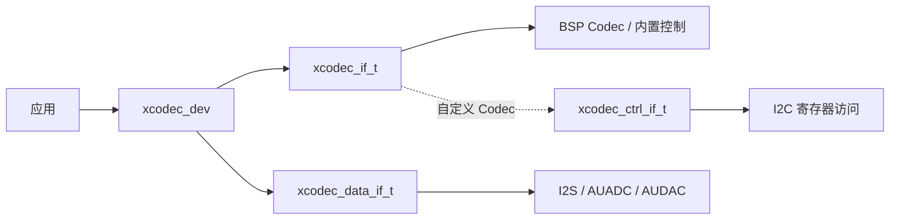

# Xcodec Device

[English](./README.md) | 中文

## 功能概述

统一音频设备接口，使用 Bouffalo LHAL 实现硬件数据传输。

- 统一的录音、播放、音量、静音和麦克风增益接口。
- 分离设备、Codec 控制和 PCM 数据传输，支持自定义 Codec 或数据后端。
- 支持 I2S 外部 Codec，以及内置 AUADC、AUDAC 和 PDM 输入。
- 驱动处理通道掩码、PCM 字节拼接、DMA 缓存及共享 I2S 双工启停。
- 应用通过默认配置覆盖 DMA 缓存和超时，通过设备 `open()` 设置采样格式。

当前板级适配如下：

| 板卡          | 录音                   | 播放                   | 数据接口         |
| ------------- | ---------------------- | ---------------------- | ---------------- |
| BL616DK       | 模拟或 PDM AUADC       | 内置 AUDAC             | 独立 AUADC/AUDAC |
| BL618DG Orion | JY6316 中的 JY6166 ADC | JY6316 中的 JY6311 DAC | 共享四槽 I2S     |

BL616DK 在 `CONFIG_AUDIO_MIC_PDM_MODE=y` 时使用 PDM，否则使用模拟输入。

当前平台数据后端仅支持 PCM16。JY6311、JY6166、JY6316 的控制复用 BSP 驱动；
Orion 的 JY6316 适配沿用 BSP 的单实例限制，不代表任意 Codec 均可创建多个硬件实例。
软件音量、自定义音量曲线和软件音量处理插件尚未实现。

> **旧接口已弃用。** `CONFIG_XCODEC`、`include/xcodec.h` 及
> `src/bl/codec/` 保留用于现有工程兼容。新工程使用 `CONFIG_XCODEC_IO` 和
> `include/xcodec_dev.h`，迁移说明见[旧接口目录](./src/bl/codec/README.md)。

## 架构

```text
xcodec/
├── xcodec_dev.c              # 通用设备生命周期、读写与控制调度
├── xcodec_dev_if.c           # 接口释放
├── include/                  # 设备 API、类型和默认实现的配置
├── interface/                # 数据、Codec 控制、寄存器通信的接口定义
├── platform/
│   ├── xcodec_data_i2s.c     # 初始化 I2S，管理双向 DMA 数据传输
│   ├── xcodec_data_audac.c   # AUDAC 数据输出
│   ├── xcodec_data_auadc.c   # AUADC/PDM 数据输入
│   ├── xcodec_ctrl_i2c.c     # I2C 寄存器通信
│   └── codec_data.c/.h       # 固定 DMA 环形缓冲、进度管理与阻塞读写
├── src/bl/codec/             # 原有 xcodec 接口使用的驱动
└── device/
    ├── include/              # 控制实现的配置和工厂接口
    ├── audio_codec/          # 直接调用 BSP audio_codec 接口
    └── builtin/              # 内置转换器的音量、静音和增益控制
```

板级 GPIO、控制总线、Codec 初始化和数据后端选择放在 BSP；应用创建设备并处理 PCM。
`include/xcodec_dev_defaults.h` 汇总平台数据接口与控制接口的工厂配置及默认初始化宏。
数据接口通过 LHAL 收发 PCM；Codec 接口负责转换器控制，不参与数据搬运。

`CONFIG_XCODEC_IO` 启用新接口，不需要启用 minialsa；数据驱动在 `platform/`
中实现，不调用 `src/bl/codec/`。收发沿用固定循环 DMA 和环形缓冲的流程。
旧接口与新接口不得同时占用同一个外设或 DMA 通道。
新接口不依赖 `msp_i2s_*` 应用钩子。



控制路径通过 `xcodec_if_t` 设置转换器的采样率、启停、音量、增益和静音。
BSP 适配器直接调用 `audio_codec_*`；自定义 Codec 可以使用
`xcodec_ctrl_if_t` 读写寄存器。数据路径通过 `xcodec_data_if_t` 收发 PCM。
GPIO、PA 时序、外设和 Codec 的组合由 Board 决定。

## 公共接口

| 接口                                          | 职责                                       |
| --------------------------------------------- | ------------------------------------------ |
| `xcodec_dev_cfg_t`                            | 组合 `dev_type/codec_if/data_if`           |
| `xcodec_dev_sample_info_t`                    | 位宽、声道数、声道掩码、采样率和 MCLK 倍频 |
| `xcodec_dev_new/open/read/write/close/delete` | 设备生命周期与数据读写                     |
| `xcodec_data_if_t`                            | PCM 数据传输                               |
| `xcodec_if_t`                                 | 转换器控制                                 |
| `xcodec_ctrl_if_t`                            | 寄存器访问                                 |

PCM 长度单位为**字节**，`read/write` 只有完成全部请求才返回 `0`，失败返回负值。
应用自行指定读写字节数，无需按 PCM 帧或 DMA 块对齐，也无需查询块长。
数据驱动在 ringbuf 边界处理转换：播放不足一帧的字节留待下次写入拼接；
录音读取一帧中的部分字节后，其余字节留给下次读取。不会丢弃或补齐用户数据，
关闭设备时清除残片。DMA 始终使用已对齐的完整硬件帧。
超时可能已传输部分数据，不能把整包重试当成无副作用的操作。
`channel` 表示物理声道数；`channel_mask=0` 选择所有声道，非零掩码选择需要的
声道，缓冲中的样本按选中声道顺序紧凑交织。音量为 0..100，麦克风增益单位为 dB。
错误码使用负值。软件音量插件及自定义音量曲线尚未实现。

例如四槽格式 `channel=4, channel_mask=0x0A` 选择 CH1 和 CH3：
`read()` 返回的 PCM 为 `CH1[0], CH3[0], CH1[1], CH3[1], ...`；
`write()` 接收同样顺序的 PCM，填入物理槽 1/3，槽 0/2 输出静音。
掩码不改变物理槽数；位不能超出 `channel` 范围，格式在 `open()` 生效。

`xcodec_dev_sample_info_t` 与 ESP 的 `esp_codec_dev_sample_info_t` 使用相同的五个字段、
类型和排列顺序：`bits_per_sample`、`channel`、`channel_mask`、`sample_rate`、`mclk_multiple`。
通道掩码同样按位选择，0 表示全部通道；实际支持的格式由后端决定，当前 xcodec 平台后端仅支持 PCM16。
MCLK 默认语义有区别：ESP 规定 `mclk_multiple=0` 默认使用 `sample_rate × 256`，
xcodec I2S 主模式接受板级选定的参考时钟并校验分频，从模式使用外部时钟；内置转换器接受 0 或 256。

## DAC 音量和麦克风控制

打开播放设备后，使用 `xcodec_dev_set_out_vol(dev, volume)` 设置 0..100 音量，
使用 `xcodec_dev_set_out_mute(dev, mute)` 控制静音。创建板级播放接口和初始化
内置 AUDAC 时默认静音；应用在打开设备后设置音量并解除静音。

设备层将音量 0 映射为 −96 dB，将 1..100 按 0.5 dB 步进映射为 −49.5..0 dB。
内置 AUDAC 使用该 dB 值，并按 LHAL 能力量化。BSP Codec 适配器将该值还原为
百分比，保留 BSP 原有曲线，因此实际 Codec 的 100 不一定是 0 dB。
例如 Orion 的 JY6311：30 约为 −58 dB，60 约为 −19.5 dB，75 为 0 dB。

`xcodec_dev_set_in_gain()` 和 `xcodec_dev_set_in_channel_gain()` 的单位是 dB；
实际范围和通道支持由 Codec 决定。内置模拟 AUADC 支持 6..42 dB、3 dB 步进；
PDM 增益和 AUADC 输入静音不支持。JY6166/JY6316 当前不支持 dB 麦克风增益和精确输入静音。
不支持的控制返回 `XCODEC_DEV_NOT_SUPPORT`，不会自动切换为软件处理。
音量、增益及静音的 getter 返回设备缓存的设置值，不读取硬件寄存器。

## 使用与配置

在工程配置中启用 `CONFIG_FREERTOS=y`、`CONFIG_XCODEC_IO=y`，并选择已适配的 Board。
完整的录放音、CLI 和错误清理流程见 [xcodec_io](../../../examples/audio/xcodec_io/README.md)。
例如在该例程目录构建：

```sh
make CHIP=bl616 BOARD=bl616dk
make CHIP=bl618dg BOARD=bl618dg_orion CPU_ID=ap
```

1. 应用按需修改驱动的 `xcodec_channel_default_config`；默认使用每块 160 帧、8 块、1000 ms。
2. `xcodec_dev_board_init()` 无参创建板级 GPIO、控制总线、Codec 及 I2S 或 AUADC/AUDAC 数据接口。
   Board 复制通道默认配置，数据 factory 分配 DMA、软件队列和任务；首次设备打开设置格式时初始化数据外设。
3. 应用将返回的数据、Codec 接口和方向填入 `xcodec_dev_cfg_t`，创建设备句柄。
4. `xcodec_dev_open()` 接收采样格式，配置数据及 Codec 的实际速率并启动路径；应用设置音量后读写 PCM。
5. 停止读写，关闭并删除设备，再调用 `xcodec_dev_board_deinit()` 释放 Board 持有的接口。

每个 Board 只初始化一次；重复调用返回 `NULL`，需要先 `deinit` 再重新初始化。

配置默认宏都在驱动中：`XCODEC_CHANNEL_DEFAULT_CONFIG()` 默认 DMA 每块 160 帧、
8 块、超时 1000 ms；`XCODEC_DEV_SAMPLE_INFO_DEFAULT_CONFIG()` 默认 PCM16、16 kHz、
单声道、全部通道、MCLK 倍频 0。应用覆盖后者的 `channel` 为硬件槽数，使用
`channel_mask` 选择需要的槽位。运行格式只在 `open()` 传入，不再传给 Board。

Board 内部使用驱动原生配置和 `XCODEC_I2S_DEFAULT_CONFIG`、
`XCODEC_AUADC_DEFAULT_CONFIG`、`XCODEC_AUDAC_DEFAULT_CONFIG`，填充接线、DMA、
槽位、输入模式和时钟回调；应用可在 Board 初始化前覆盖通用默认配置，无需判断后端类型：

```c
/* 可选：不修改则直接使用驱动默认值。 */
xcodec_channel_default_config.block_frames = 320;
xcodec_channel_default_config.period_count = 4;
xcodec_channel_default_config.timeout_ms = 500;
```

以下片段展示成功路径；实际调用应检查创建结果和 API 返回值，完整错误处理见例程。
应用包含 `board.h`、`board_audio.h` 和 `xcodec_dev.h`，创建播放设备：

```c
xcodec_board_handle_t board = xcodec_dev_board_init();
xcodec_dev_cfg_t cfg = {
    .dev_type = XCODEC_DEV_TYPE_OUT,
    .codec_if = board->play_codec,
    .data_if = board->play_data,
};
xcodec_dev_handle_t play_dev = xcodec_dev_new(&cfg);
xcodec_dev_sample_info_t format = XCODEC_DEV_SAMPLE_INFO_DEFAULT_CONFIG();
format.channel = BOARD_AUDIO_CHANNELS;
format.channel_mask = 0x01; /* 播放到 CH0，其他物理槽输出静音。 */
xcodec_dev_open(play_dev, &format);
xcodec_dev_set_out_vol(play_dev, 60);
xcodec_dev_set_out_mute(play_dev, false);

int16_t silence[256] = {0};
xcodec_dev_write(play_dev, silence, sizeof(silence));
```

同一 Board 上创建独立录音设备：

```c
xcodec_dev_cfg_t record_cfg = {
    .dev_type = XCODEC_DEV_TYPE_IN,
    .codec_if = board->record_codec,
    .data_if = board->record_data,
};
xcodec_dev_handle_t record_dev = xcodec_dev_new(&record_cfg);
xcodec_dev_sample_info_t record_format = {
    .bits_per_sample = 16,
    .channel = BOARD_AUDIO_CHANNELS,
    .channel_mask = 0, /* 返回全部物理槽。 */
    .sample_rate = 16000,
    .mclk_multiple = 0,
};
xcodec_dev_open(record_dev, &record_format);

int16_t capture[256];
xcodec_dev_read(record_dev, capture, sizeof(capture));
```

只录音时可以只创建设备并打开录音句柄，无需打开播放设备或调用 `write()`。
停止读写，关闭两个设备并确认成功后，再删除设备和释放 Board：

```c
xcodec_dev_close(record_dev);
xcodec_dev_close(play_dev);
xcodec_dev_delete(record_dev);
xcodec_dev_delete(play_dev);
xcodec_dev_board_deinit();
```

`xcodec_i2s_cfg_t.config` 保存原生 I2S 配置；AUADC/AUDAC 使用各自原生 `config`。
运行采样率覆盖原生配置中的速率/分频字段。可选 `set_clock` 回调在停止状态下配置板级参考时钟。
Orion 提供 PLL 回调；内置转换器 BSP 在初始化时设置所有双工可用速率共用的参考时钟，
打开第二个方向不会重复切换 PLL。
DMA 块数为 2..1023；块长或超时传 0 使用驱动默认值，DMA 块需满足长度和缓存行对齐限制。

驱动中定义的 `xcodec_channel_default_config` 使用默认宏初始化；应用可直接修改字段或赋值自己的通道配置。
修改需在 Board 初始化前串行完成，创建后的数据接口不引用该对象；重新应用配置需先停止并 deinit/reinit。
板级入口创建的数据与 Codec 接口由 Board 持有，设备只借用它们。
同一 I2S 数据接口可供独立 IN/OUT 设备共用，一个方向只有一个所有者；
内置 AUADC/AUDAC 各有一个数据接口。Codec 控制接口归单个设备使用。
更换 Codec 修改板级控制接口，数据驱动不依赖 Codec 型号。

共享 I2S 首个方向打开后启动所有已配置 DMA；放音未打开或队列为空发送静音，
录音未打开时丢弃数据。打开或关闭另一方向不重启 DMA，最后一个方向关闭才停止总线。
应用无需预填静音或额外读取首块录音。另一方向运行时禁止改变物理采样率。

停止所有读写后，先检查 `xcodec_dev_close()` 成功并删除设备，再调用
`xcodec_dev_board_deinit()`。Board 先释放数据接口（共享接口只删一次），然后释放录音、
播放控制接口；数据删除时释放 DMA 并反初始化 I2S。Orion 的原生 Codec 由 Board
初始化和反初始化，两个控制接口只借用它。
Board 初始化失败时自动清理已创建的部分接口；清理失败可调用 deinit 重试。
释放失败时保留仍被引用的资源，禁止继续释放下层；应用不能自行删除 Board 持有的接口。

### BSP 控制接口

`audio_codec_*` 统一分发方向启停、dB 麦克风增益、通道增益、输入静音、寄存器读写、
寄存器导出和反初始化；旧的百分比音量/PGA 接口保持原有含义。
新操作缺少驱动回调时返回不支持；单通道增益不会退化成修改所有通道。
方向启停回调允许缺省，不影响设备打开；已实现回调返回的错误仍向上传递。
`set_fs` 通过 `audio_codec_set_sample_rate` 设置采样率；位宽和物理槽位由数据接口约束。

新增控制当前仅在 JY6311、JY6166 及其 JY6316 组合驱动中实现；
其他 Codec 的新增回调留空，调用返回不支持，原有控制功能保留。
JY6166 及 JY6316 的 dB 麦克风增益和精确输入静音仍不支持。

寄存器地址和值保留驱动原生格式；JY6316 高字节 0/1 分别选择 JY6311/JY6166。
寄存器操作由统一接口保护共享 I2C，读失败时不更新输出值。

## 硬件范围与缓存

- 支持 BL616、BL618DG；数据后端当前实现原生 PCM16。
- I2S 运行采样率由 `open` 指定。主模式通过可选板级时钟回调配置参考时钟，再使用
  最近整数分频并允许 100 ppm 的 PLL 量化误差；从模式使用外部 BCLK/FS，不检查本地
  分频和 MCLK 倍频。不隐式重采样，另一方向运行时拒绝改变物理采样率。
  AUDAC/AUADC 在停止状态下按运行采样率配置转换器；PDM 使用 AUADC 后端的输入模式。
- 外部 Codec 初始化及控制复用 BSP 驱动；当前板级配置为 JY6316，沿用其单实例限制。
- AUADC 输入静音缺少 LHAL 控制接口，返回不支持。AUDAC 音量通过现有 LHAL
  量化到整数 dB。
- I2S、AUADC、AUDAC 后端配置各自的 DMA 请求、FIFO 地址和硬件启停；
  `codec_data.c` 管理公共环形缓冲。DMA 中断只直接通知处理任务，任务按
  DMA 完成计数更新读写进度。I2S burst 根据板级 FIFO 门限选择，与 Codec 型号无关。
- 应用 PCM 读写软件队列，DMA 任务在已完成的块与软件队列之间搬运数据，
  避免应用直接访问正在传输的 DMA 块。I2S 非合并 FIFO 或部分声道掩码在
  队列边界完成槽位提取或填充。槽位和 FIFO 打包方式来自板级配置。
- 每个方向在创建数据接口时按 `period_count` 分配 DMA 环形缓冲、同容量软件队列、描述符、
  处理任务和同步资源。`open/close/read/write`
  及普通启停不重新分配；删除数据接口时统一释放。
  `period_count` 必须由创建配置传入，范围为 2..1023，没有隐式默认值。
  环形缓冲字节数为 `period_count × block_frames × slots × FIFO 样本存储字节数`，
  每周期字节数须按 Cache 行对齐。PCM16 的每个采样为 2 字节；
  当前 Orion 关闭 I2S FIFO 合并，DMA 缓冲按每个采样 4 字节存储，
  因此单方向 DMA 为 `8 × 160 × 4 × 4 = 20480` 字节，软件队列另占 20480 字节，
  录放音的 DMA 和队列合计 80 KiB，
  不含描述符、任务及同步资源。
- 放音 DMA 打开时从静音开始；软件队列没有音频时填零，持续运行并保持共享时钟。
  逻辑录音关闭时丢弃数据，重新打开后跳过横跨打开时刻的采样块。
  逻辑录音已打开却未及时读取导致队列溢出时返回错误，物理 DMA 继续运行；
  关闭并重新打开录音设备可恢复，不影响播放。
  完成任务必须在 DMA 再次使用待处理块前完成搬运；`period_count` 和块长也影响缓冲时延。

## 适配新的 Codec 或平台

1. 优先复用已有数据后端。I2S 外部 Codec 使用 `xcodec_i2s_data_new()`，
   内置转换器使用 `xcodec_auadc_data_new()`、`xcodec_audac_data_new()`。
   默认配置宏及结构体见 [xcodec_dev_defaults.h](./include/xcodec_dev_defaults.h)。
2. 实现 [xcodec_if_t](./interface/xcodec_if.h)，提供 Codec 支持的启停、采样率和控制回调。
   其他回调可留空，不支持的操作由设备层返回错误。当前 BSP 适配器通过
   `xcodec_ctrl_if_new()` 创建；也可参考 [audio_codec](./device/audio_codec/xcodec_audio_codec.c)
   和 [builtin](./device/builtin/xcodec_builtin_codec.c) 实现。
3. 自定义寄存器控制可复用 `xcodec_i2c_ctrl_new()`；地址为七位 I2C 地址。
   实现 [xcodec_ctrl_if_t](./interface/xcodec_ctrl_if.h) 可接入其他控制总线。
   当前 BSP 适配器直接调用 BSP，不会自动使用新建的寄存器接口。
4. 在 Board 中配置 GPIO、时钟、DMA 和 Codec，返回 `play_codec/record_codec` 及
   `play_data/record_data`。应用的设备调用和 PCM 处理无需依赖 Codec 型号。
5. 新数据外设实现 [xcodec_data_if_t](./interface/xcodec_data_if.h)；移植到其他平台时，
   替换 [platform](./platform) 的硬件实现，并适配对应 RTOS、缓存和同步操作。

接口由创建方持有；设备只借用接口。自定义数据接口仍需遵守字节长度、完整传输返回值、
方向启停及资源释放约定，不能把 DMA 块对齐要求转交给应用。

## 旧接口迁移

旧 `xcodec.h`、`xcodec_input_*`、`xcodec_output_*` 已弃用，参见
[迁移说明](./src/bl/codec/README.md)。新接口不是旧结构体和回调 API 的直接替换；
需要改为设备句柄和 `new/open/read/write/close/delete` 流程。
